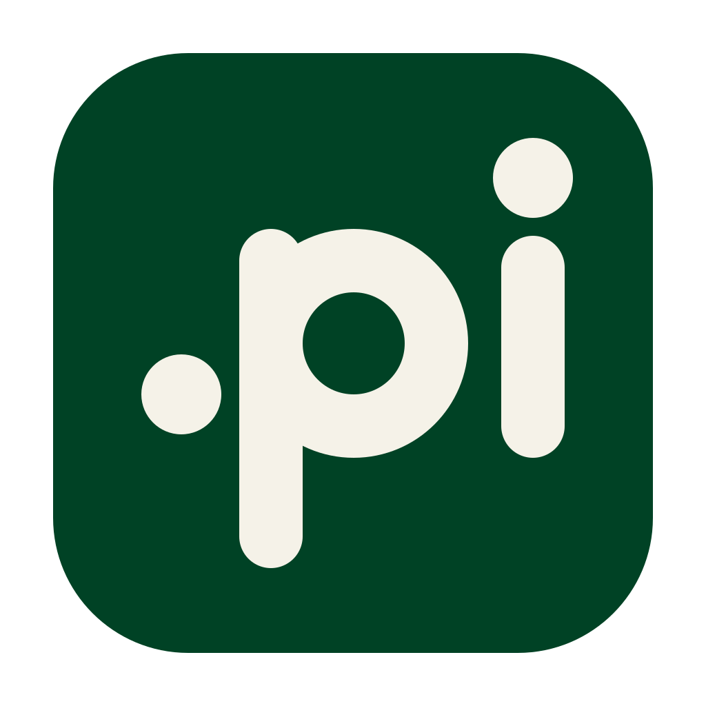

<p align="center"></p>

# Pinion

AI가 작성하고 디버깅하기 쉬운 객체 지향 언어. 확장자는 `.pi`, Go로 컴파일된다.

> 상태: **v0 구현**. 컴파일러(`go build -o bin/pinion ./cmd/pinion`), 표준 라이브러리(HTTP·JSON 포함), 테스트 도구가 동작한다. 벤치마크: [bench/ai/results/SUMMARY.md](bench/ai/results/SUMMARY.md)

- [설계 문서](docs/DESIGN.md): 의미 규칙과 결정 기록
- [구현 계획](docs/PLAN.md): v0 범위와 마일스톤
- [레퍼런스 카드](spec/REFERENCE-CARD.md): AI 에이전트용 한 장 요약(핵심 규칙, 표준 API, CRUD 예제). 먼저 이것만 읽으면 된다
- [핵심 가이드](spec/GUIDE.md), [표준 라이브러리](spec/STDLIB.md): 전체 문서
- [적합성 예제](spec/conformance/): 규칙별 정상·에러·경계 사례

```pinion
data User {
  pub name: Str
  pub email: Str?
}

fn greet(u: User) -> Str {
  "hello, {u.name}"
}

fn main() !io {
  print(greet(User(name: "pinion", email: None)))
}
```

## 라이선스

[Apache License 2.0](LICENSE)
